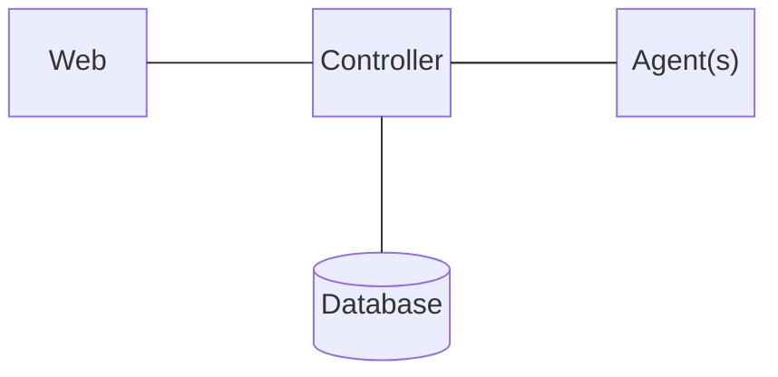

# Phantom Panel

Phantom Panel is a **work-in-progress** web interface for managing Minecraft servers.

# Architecture



Phantom Panel has 3 types of services:

1. The **Controller** service manages state and persists it to a PostgreSQL database.
2. The **Web** service provides a web user interface.
3. One or more **Agent** services run the actual game servers.

This architecture allows deploying Agents on many physical servers in different geographical locations, and managing all of their game servers from one place.

The Web requires an active connection to the Controller to work. The Controller and Web should always be updated at the same time, to the same version of Phantom Panel.

Agents require a connection to the Controller during startup, and to continue receiving configuration changes and send back status information and game server logs, but they will continue to work when the Controller is offline.

> [!NOTE]
> To avoid using too much memory, Agents may discard game server logs during Controller downtime.

When a new Phantom Panel version is released, the new Controller will, at minimum, be compatible with Agents that are one version behind it.

This means the Controller can be updated without also having to update and restart all connected Agents. After updating the Controller and Web, Agent updates can wait until off-peak hours to reduce game interruptions.

> [!CAUTION]
> Compatibility between different versions of Controller and Agents is not guaranteed for development builds of Phantom Panel.

# Usage

This project is **work-in-progress**, and currently has no official releases. Feel free to build it from source to try it, but expect bugs and breaking changes that will require knowledge of the source code to resolve.

For a quick start, I recommend using [Docker](https://www.docker.com/) or a compatible containerization platform. The `Dockerfile` in the root of the repository can be used to build an image for each of the 3 Phantom Panel services:

```bash
docker build --pull --tag phantom-agent      --target phantom-agent      .
docker build --pull --tag phantom-controller --target phantom-controller .
docker build --pull --tag phantom-web        --target phantom-web        .
```

All images put the built application into the `/app` directory, and set the working directory to the `/data`. The Agent image includes Java 8, 16, 17, and 21.

Files are stored relative to the working directory. Read the **Storage** section under each service for more information.

Services are configured primarily using environment variables.

> [!IMPORTANT]
> Due to .NET having inconsistent TLS support across operating systems, Phantom Panel is **intended to run on Linux with up-to-date OpenSSL libraries**. Support for other operating systems only exists for local development. Services running on different operating systems may not be able to communicate with each other.

### Logging

All services support an optional `LOG_LEVEL` environment variable to set the minimum log level. Possible values:

* `VERBOSE` (Default for Debug builds)
* `DEBUG`
* `INFORMATION` (Default for Release builds)
* `WARNING`
* `ERROR`

## Controller

The Controller runs two RPC servers for communication with the Web and Agents, and a PostgreSQL database client.

### Secrets

In order for the Web and Agents to connect to the Controller, they must be configured with their own **Key**, which combines a TLS certificate's public key thumbprint and an authentication token.

When the Controller starts for the first time, it generates two TLS certificate files (`agent.pfx` and `web.pfx`), and a Web authentication token file (`web.auth`). These files must only be accessible to the Controller itself.

As there is only one Web service, the Controller generates only one Web authentication token, and prints the **Web Key** to standard output on every start. Once you set up the Web service, you can obtain **Agent Keys** through the web interface.

### Storage

The entire working directory must be persisted.

### Environment variables

* **Agent RPC Server**
  - `AGENT_RPC_SERVER_HOST` is the host. Default: `0.0.0.0`
  - `AGENT_RPC_SERVER_PORT` is the port. Default: `9401`
* **Web RPC Server**
  - `WEB_RPC_SERVER_HOST` is the host. Default: `0.0.0.0`
  - `WEB_RPC_SERVER_PORT` is the port. Default: `9402`
* **PostgreSQL Database Connection**
  - `PG_HOST` is the hostname.
  - `PG_PORT` is the port.
  - `PG_USER` is the username.
  - `PG_PASS` is the password.
  - `PG_DATABASE` is the database name.

## Web

### Storage

The entire working directory must be persisted.

### Environment Variables

* **Controller RPC Client**
  - `CONTROLLER_HOST` is the hostname of the Controller.
  - `CONTROLLER_PORT` is the Web RPC port of the Controller. Default: `9402`
  - `WEB_KEY` is the [Web Key](#secrets). Mutually exclusive with `WEB_KEY_FILE`.
  - `WEB_KEY_FILE` is a path to a file containing the [Web Key](#secrets). Mutually exclusive with `WEB_KEY`.
* **Web Server**
  - `WEB_SERVER_HOST` is the host. Default: `0.0.0.0`
  - `WEB_SERVER_PORT` is the port. Default: `9400`
  - `WEB_BASE_PATH` is the base path of every URL. Must begin with a slash. Default: `/`

## Agent

### Storage

Two folders will be created in the working directory:

* `data` for persistent files
* `temp` for volatile files, such as downloaded Minecraft `.jar` files

Only the `data` folder must be persisted, but you may choose to persist the entire working directory.

### Environment Variables

* **Controller RPC Client**
  - `CONTROLLER_HOST` is the hostname of the Controller.
  - `CONTROLLER_PORT` is the Agent RPC port of the Controller. Default: `9401`
  - `AGENT_KEY` is the [Agent Key](#secrets). Mutually exclusive with `AGENT_KEY_FILE`.
  - `AGENT_KEY_FILE` is a path to a file containing the [Agent Key](#secrets). Mutually exclusive with `AGENT_KEY`.
* **Agent Configuration**
  - `MAX_INSTANCES` is the number of instances (game servers) that can be created.
  - `MAX_MEMORY` is the maximum amount of RAM that can be distributed among all instances. Use a positive integer with an optional suffix 'M' for MB, or 'G' for GB. Examples: `4096M`, `16G`
  - `MAX_CONCURRENT_BACKUP_COMPRESSION_TASKS` is how many backup compression tasks can run at the same time. Smaller numbers limit memory usage, but increase time between backups, because the next backup is only scheduled once the current one completes. Default: `1`
* **Minecraft Configuration**
  - `JAVA_SEARCH_PATH` is a path to a directory containing Java runtimes. Linux default: `/usr/lib/jvm`
  - `ALLOWED_SERVER_PORTS` is a comma-separated list of ports and port ranges that can be used as Minecraft Server ports. Example: `25565,25900,26000-27000`
  - `ALLOWED_RCON_PORTS` is a comma-separated list of ports and port ranges that can be used as Minecraft RCON ports. Example: `25575,25901,36000-37000`

# Development

The repository includes a [Rider](https://www.jetbrains.com/rider/) project. The `.workdir` folder in the root of the repository is used for storage, including pre-generated secret files **for development only**.

## Prerequisites

You will need a PostgreSQL database with the following configuration:

* Host: `localhost`
* Port: `9403`
* User: `postgres`
* Password: `development`
* Database: `postgres`

> [!TIP]
> If you have [Docker](https://www.docker.com/) configured in Rider, you can use the `PostgreSQL` run configuration to launch a pre-configured PostgreSQL server. Alternatively, you can enter the `Docker` folder and run `docker compose up`.

You will also need to install at least one Java runtime (for example, [Eclipse Temurin](https://adoptium.net/temurin/releases)) into the `~/.jdks` folder (`%USERPROFILE%\.jdks` on Windows).

## Initial Setup

1. Launch the `Controller` and `Web` run configurations.
2. Visit [localhost:9400](http://localhost:9400/) and create an account.
3. Visit [localhost:9400/agents](http://localhost:9400/agents), create 1-3 Agents, and save each Agent's key into its respective file:
   - `.workdir/Agent1/key`
   - `.workdir/Agent2/key`
   - `.workdir/Agent3/key`

After the initial setup, you can launch any of the Agent run configurations:

* `Agent 1`
* `Agent 2`
* `Agent 3`

You can also use these run configurations to launch multiple services at the same time:

* `Controller + Web + Agent`
* `Controller + Web + Agent x3`

## Database

The project includes the [dotnet-ef](https://www.nuget.org/packages/dotnet-ef/) tool, which can be installed or updated using the `dotnet tool restore` command.

After making a change to the database schema, run the `AddMigration` script to generate an EF migration:

* `AddMigration.bat <migration-name>`
* `AddMigration.sh <migration-name>`

## Bootstrap

The project uses [Bootstrap 5](https://getbootstrap.com/docs/5.2) with a custom theme and several other customizations. The sources are in the `Phantom.Server.Web.Bootstrap` project.

After making a change to the sources, run the `Compile Bootstrap` run configuration and restart the Web service. Compiling Bootstrap requires [Node](https://nodejs.org/en/) and [npm](https://www.npmjs.com/).
